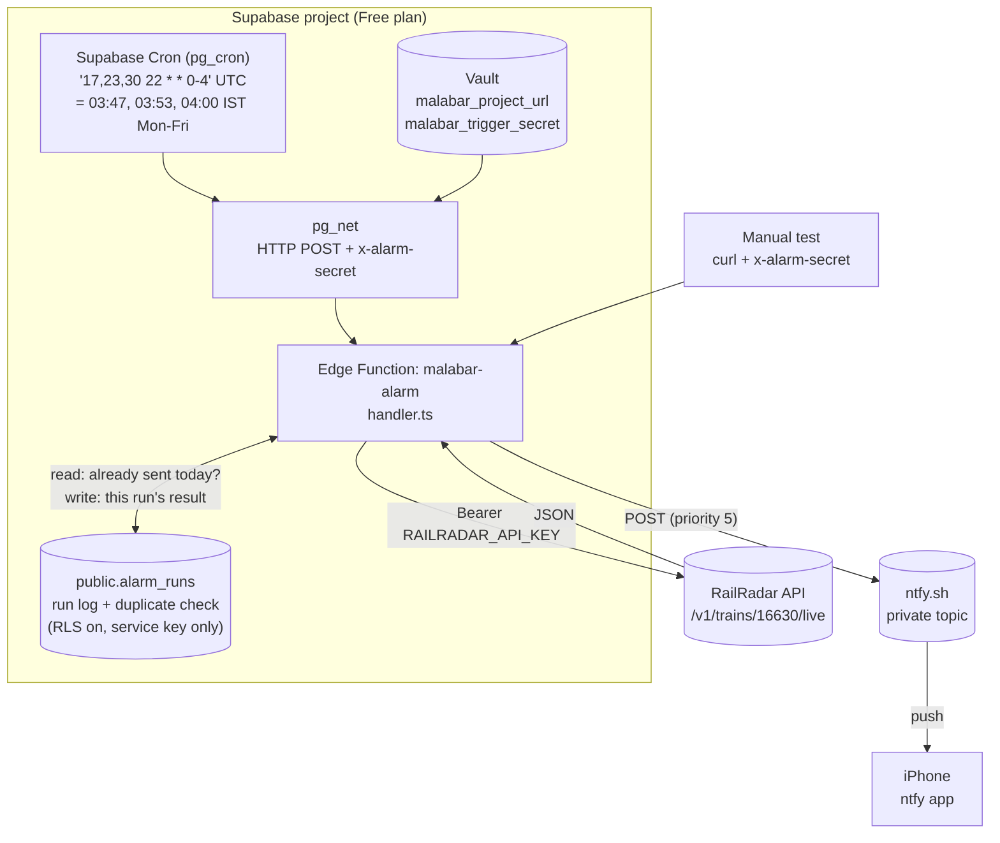

# Malabar Smart Alarm

Every Monday to Friday before dawn, this project checks the live running status of
**16630 Malabar Express**. It works out when you should wake up to catch the train at
**Chengannur (CNGR)** and sends that time to your iPhone as a push notification through **ntfy**.

```
Malabar Smart Alarm
Train: Malabar Express (16630)
Boarding: Chengannur (CNGR)
Date: Thu 12 Nov 2026
Predicted arrival: 05:14 AM
Recommended wake-up: 04:34 AM
Buffer: 40 minutes
Delay: 23 minutes
Status: LIVE
Source: RailRadar (predicted)
```

It runs entirely on the **Supabase Free plan**, which needs no payment card:

- a **Supabase Edge Function** (TypeScript/Deno) does the work
- **Supabase Cron** (pg_cron + pg_net) runs it on a schedule
- a small **Postgres table** keeps a log of runs and prevents duplicate notifications

It also uses the RailRadar API and **ntfy.sh** (free).

> **Important:** This sends a **notification**. It does **not** create or change alarms in the
> iPhone Clock app. Configure ntfy as described below so the notification can wake you.

---

## Contents

1. [How it works](#how-it-works)
2. [What LIVE / SCHEDULED / FALLBACK mean](#status)
3. [Deployment checklist](#checklist)
4. [Step 1 - Create a Supabase project](#step-1)
5. [Step 2 - Link this folder to the project](#step-2)
6. [Step 3 - Create the database table and schedule](#step-3)
7. [Step 4 - Set the function secrets](#step-4)
8. [Step 5 - Deploy the Edge Function](#step-5)
9. [Step 6 - Give the schedule its Vault secrets](#step-6)
10. [Step 7 - Test manually](#step-7)
11. [ntfy and iPhone setup](#ntfy)
12. [Scheduling, timezones and delays](#scheduling)
13. [Free plan: keeping the project awake](#pausing)
14. [Changing train, station, buffer and schedule](#changing)
15. [Troubleshooting](#troubleshooting)
16. [Security and rotating credentials](#security)
17. [Running tests locally](#tests)
18. [Project structure](#structure)

---

<a id="how-it-works"></a>
## 1. How it works



Each run does this:

1. **Checks the caller.** The request must carry the `x-alarm-secret` header, and its value must match the `ALARM_TRIGGER_SECRET` secret.
2. **Checks the day.** It continues only on Monday to Friday, India time (IST). Manual runs (`"force": true`) skip this check.
3. **Calls RailRadar.** It sends `GET https://api.railradar.in/v1/trains/16630/live`, waiting up to 15 seconds and retrying once on a timeout or server error.
4. **Validates the response.** `success` must be true, `data.train.number` must be `16630`, and `data.route[]` must contain a stop with `stationCode = CNGR`.
5. **Picks the arrival time** at Chengannur. It uses arrival, not departure.
6. **Works out the wake-up time:** arrival − 40 minutes, in IST.
7. **Checks for duplicates.** It looks in `alarm_runs` to see if today's notification was already sent. If it was, it records the run as `skipped` and stops.
8. **Sends the notification.** It posts it to ntfy and records the run. The outcome is only recorded as `sent` if ntfy confirms it received the message.

<a id="status"></a>
## 2. What LIVE / SCHEDULED / FALLBACK mean

| Status | When | Arrival used |
|---|---|---|
| **LIVE** | `actualArrival` for CNGR is present and valid | RailRadar's predicted (or actual) arrival |
| **SCHEDULED** | API worked but `actualArrival` is empty or invalid | `scheduledArrival` (timetable) |
| **FALLBACK** | API down, timed out, bad JSON, wrong train, CNGR missing, no times, **or the data is for a different day** | Configured timetable arrival `04:51` → wake-up **04:11** |

Anything other than LIVE has the status in its title and includes a `Reason:` line. Out-of-date data is never presented as LIVE.

**Duplicate protection:** three runs are scheduled each morning so that one failed run doesn't mean no notification. The first successful run sends the notification. Later runs find a `sent` row for that date in `alarm_runs` and skip. There is one exception: an earlier SCHEDULED or FALLBACK notification is replaced by a LIVE one if a later run gets a prediction. Manual runs never block or get blocked by the scheduled ones.

---

<a id="checklist"></a>
## 3. Deployment checklist

- [ ] Supabase account and a new **Free** project in region **Mumbai** ([Step 1](#step-1))
- [ ] `supabase login` and `supabase link` ([Step 2](#step-2))
- [ ] `supabase db push` creates the table and the cron job ([Step 3](#step-3))
- [ ] Secrets set: `RAILRADAR_API_KEY`, `NTFY_TOPIC`, `ALARM_TRIGGER_SECRET` ([Step 4](#step-4))
- [ ] `supabase functions deploy malabar-alarm --no-verify-jwt` ([Step 5](#step-5))
- [ ] Two Vault secrets created in the SQL editor ([Step 6](#step-6))
- [ ] ntfy app installed, subscribed, notifications allowed, Sleep Focus exception added ([ntfy setup](#ntfy))
- [ ] Manual dry run returns `"outcome": "dry_run"` with sensible times ([Step 7](#step-7))
- [ ] Manual real run puts a notification on the iPhone ([Step 7](#step-7))
- [ ] Next weekday: `alarm_runs` shows one `sent` row and two `skipped` rows
- [ ] For the first two weeks, check the dashboard to make sure the project is not paused ([pausing](#pausing))

---

<a id="step-1"></a>
## Step 1 - Create a Supabase project

1. Sign up at <https://supabase.com> (free, no card needed).
2. **New project** → choose your organisation → name it `malabar-smart-alarm`.
3. **Database password:** click *Generate a password* and save it in your password manager. The CLI asks for it once in Step 2.
4. **Region:** *South Asia (Mumbai)*. It's closest to RailRadar and to you.
5. Plan: **Free**. Click **Create new project** and wait about 2 minutes.
6. Note the **Project ref**, the random ID in the project URL: `https://supabase.com/dashboard/project/<project-ref>`.

<a id="step-2"></a>
## Step 2 - Link this folder to the project

The Supabase CLI is installed with `brew install supabase/tap/supabase`.

```bash
cd /path/to/malabar-smart-alarm
```

```bash
supabase login
```

```bash
supabase link --project-ref <project-ref>
```

`supabase login` opens a browser to approve access. `supabase link` asks for the database password from Step 1.

<a id="step-3"></a>
## Step 3 - Create the database table and schedule

```bash
supabase db push
```

This applies [`supabase/migrations/20261111180000_malabar_alarm.sql`](supabase/migrations/20261111180000_malabar_alarm.sql), which:

- creates the `public.alarm_runs` table with Row Level Security on, so the public keys can't read or write it
- turns on `pg_cron` and `pg_net`
- schedules the `malabar-alarm` cron job and a daily clean-up job

No secrets are stored in this file.

<a id="step-4"></a>
## Step 4 - Set the function secrets

First generate a random trigger secret. It stops anyone else from calling your function:

```bash
openssl rand -hex 32
```

Then add the secrets in the **dashboard**, so they never end up in your shell history: **Edge Functions → Secrets → Add new secret**.

| Name | Value | Required |
|---|---|---|
| `RAILRADAR_API_KEY` | Your RailRadar key: the part *after* `Bearer ` | Yes |
| `NTFY_TOPIC` | Your ntfy topic name (just the name, not the URL) | Yes |
| `ALARM_TRIGGER_SECRET` | The `openssl` value above. Keep it: Step 6 and manual tests need it | Yes |
| `NTFY_TOKEN` | ntfy access token, only for protected topics or self-hosted ntfy | No |

**Optional settings.** Add these as secrets too, only if you want to change a default:

| Name | Default | Example |
|---|---|---|
| `BUFFER_MINUTES` | `40` | `30` |
| `FALLBACK_SCHEDULED_ARRIVAL` | `04:51` (24-hour clock, IST) | `04:45` |
| `MONITORING_DAYS` | `MON-FRI` | `MON-SAT` |
| `TRAIN_NUMBER` / `TRAIN_NAME` | `16630` / `Malabar Express` | |
| `BOARDING_STATION_CODE` / `BOARDING_STATION_NAME` | `CNGR` / `Chengannur` | `KTYM` / `Kottayam` |
| `NTFY_PRIORITY` | `5` (max) | `4` |
| `NTFY_SERVER` | `https://ntfy.sh` | your server (HTTPS only) |

You don't need to set `SUPABASE_URL` or the service key. Supabase gives them to every Edge Function automatically.

<a id="step-5"></a>
## Step 5 - Deploy the Edge Function

```bash
supabase functions deploy malabar-alarm --no-verify-jwt
```

`--no-verify-jwt` (also set in `supabase/config.toml`) means Supabase doesn't require a login token to call the function. The function protects itself with `ALARM_TRIGGER_SECRET` instead. Without the right header, it replies `401 Unauthorized` and does nothing.

<a id="step-6"></a>
## Step 6 - Give the schedule its Vault secrets

The cron job reads the function's address and the trigger secret from **Supabase Vault**, so neither is written in the migration. Open **SQL Editor → New query** and run this once, with your own values:

```sql
select vault.create_secret('https://<project-ref>.supabase.co', 'malabar_project_url');
select vault.create_secret('<ALARM_TRIGGER_SECRET from Step 4>', 'malabar_trigger_secret');
```

To check them (this shows only the names, not the values):

```sql
select name, created_at from vault.secrets where name like 'malabar_%';
```

<a id="step-7"></a>
## Step 7 - Test manually

Replace `<project-ref>`. The trigger secret is read silently, so it isn't saved in your shell history.

**Dry run:** works everything out and returns the message, but sends nothing:

```bash
read -rs ALARM_SECRET && curl -sS -X POST "https://<project-ref>.supabase.co/functions/v1/malabar-alarm" -H "x-alarm-secret: $ALARM_SECRET" -H "Content-Type: application/json" -d '{"force": true, "dry_run": true}'; unset ALARM_SECRET
```

**Real notification to your iPhone:**

```bash
read -rs ALARM_SECRET && curl -sS -X POST "https://<project-ref>.supabase.co/functions/v1/malabar-alarm" -H "x-alarm-secret: $ALARM_SECRET" -H "Content-Type: application/json" -d '{"force": true}'; unset ALARM_SECRET
```

Request options:

| Option | Meaning |
|---|---|
| `"force": true` | Manual run: ignores the weekday check, always sends, adds "(Manual test run)", and never affects duplicate protection |
| `"dry_run": true` | Don't send. Return the message instead |
| `"skip_dedupe": true` | Scheduled-style run that sends even if one was already sent |

After 12:00 noon IST, a run looks at **tomorrow morning's** arrival, which is tonight's train. Before noon it looks at today's.

A successful real run returns something like:

```json
{ "outcome": "sent", "status": "LIVE", "arrival": "05:14", "wakeup": "04:34", "ntfyMessageId": "..." }
```

You can also run it from the dashboard: **Edge Functions → malabar-alarm → Test**. Add the `x-alarm-secret` header and a body.

---

<a id="ntfy"></a>
## ntfy and iPhone setup

1. **Choose a topic.** On ntfy.sh, anyone who knows a topic name can read and post to it. Generate a long random one:
   ```bash
   python3 -c "import secrets; print('malabar-' + secrets.token_urlsafe(18))"
   ```
2. **Install ntfy** from the App Store (publisher: Philipp Heckel). Tap **+**, paste the topic, keep the server as `https://ntfy.sh`, tap **Subscribe**, and tap **Allow** when asked about notifications.
3. **Allow notifications.** In **Settings → Notifications → ntfy**, turn on Lock Screen, Notification Centre, Banners (*Persistent*), Sounds, and Time Sensitive.
4. **Let it through overnight.** In **Settings → Focus → Sleep → Apps**, add **ntfy** so it can get through during Sleep Focus.
5. **Test from your Mac:**
   ```bash
   curl -H "Title: Test" -H "Priority: 5" -d "Hello from my Mac" https://ntfy.sh/YOUR-TOPIC
   ```

> To be safe, keep a regular Clock alarm at your earliest usual time (for example the 04:11 fallback) as a backup.

---

<a id="scheduling"></a>
## Scheduling, timezones and delays

- **Timezone:** Supabase Cron (pg_cron) schedules run in **UTC (GMT)**. IST is UTC+5:30, so 03:47, 03:53 and 04:00 IST Monday to Friday are **22:17, 22:23 and 22:30 UTC the previous day, Sunday to Thursday**:
  ```
  '17,23,30 22 * * 0-4'
  ```
  `0-4` means Sun–Thu. It's not a typo: the UTC day is one day behind IST at that hour. A test checks this conversion.
- **Double check:** the function also checks the weekday in IST, so even a wrong schedule can't send on a weekend.
- **Delays:** pg_cron starts jobs within seconds, but pg_net sends the request in the background, and the function can take up to about a minute when RailRadar is slow (timeouts and retries). The first run is at 03:47, more than 20 minutes before the earliest fallback wake-up time (04:11).
- **See what ran:**
  ```sql
  select jobname, schedule, active from cron.job;
  select jobid, status, start_time, return_message from cron.job_run_details order by start_time desc limit 10;
  select id, status_code, created from net._http_response order by created desc limit 10;
  select created_at, journey_date, status, outcome, wakeup at time zone 'Asia/Kolkata' as wakeup_ist, reason
    from public.alarm_runs order by created_at desc limit 10;
  ```

<a id="pausing"></a>
## Free plan: keeping the project awake

Supabase **pauses Free-plan projects after about a week of low database activity**. A paused project runs **no** cron jobs, so no notification would be sent.

- Every run, including skipped ones, reads from and writes to `alarm_runs` through the API. That happens at least every 3 days (Friday to Monday is the longest gap). Supabase doesn't say officially whether this counts as activity, so **watch it for the first two weeks**.
- Supabase emails you before pausing. If the project gets paused, open the dashboard and click **Restore**, then run the dry-run test.
- If pausing keeps happening, the reliable fix is the Supabase **Pro** plan (paid). Or go back to the GitHub Actions version in this repository's git history (commit `0df4a05`).

---

<a id="changing"></a>
## Changing train, station, buffer and schedule

- **Buffer, fallback time, days, station or train:** set the matching secret (Step 4). Changes apply from the next run. You don't need to redeploy. The defaults are in [`config.ts`](supabase/functions/malabar-alarm/config.ts).
- **Fallback time:** set `FALLBACK_SCHEDULED_ARRIVAL` to the **timetable arrival** at your station. The wake-up time is that minus the buffer.
- **Different boarding station:** set `BOARDING_STATION_CODE`, exactly as it appears in the API's `route[]`, plus `BOARDING_STATION_NAME` and `FALLBACK_SCHEDULED_ARRIVAL`. Then do a dry run.
- **Run time:** convert IST to UTC (subtract 5 h 30 min; if the result is before midnight, the UTC day is the previous one). Then update the job in the SQL editor:
  ```sql
  select cron.alter_job(job_id := (select jobid from cron.job where jobname = 'malabar-alarm'),
                        schedule := '45 21 * * 0-4');  -- = 03:15 IST Mon-Fri
  ```
  Also update the migration file so the repository matches.
- **Pause notifications** (for example on holiday):
  ```sql
  select cron.alter_job(job_id := (select jobid from cron.job where jobname = 'malabar-alarm'), active := false);
  ```
  Use `active := true` to resume. Pausing notifications this way also stops the database activity, so the project may get paused after a week. See [pausing](#pausing).
- **Trains arriving in the afternoon or evening:** the function assumes the journey being checked arrives on the day of the run (before noon). Adjust `journeyDateFor` in [`handler.ts`](supabase/functions/malabar-alarm/handler.ts).

---

<a id="troubleshooting"></a>
## Troubleshooting

Logs are at **Dashboard → Edge Functions → malabar-alarm → Logs**. Every line starts with `[malabar]`.

| Symptom / message | Meaning and fix |
|---|---|
| `401 Unauthorized` | `x-alarm-secret` doesn't match `ALARM_TRIGGER_SECRET`. For scheduled runs, check the `malabar_trigger_secret` Vault secret has exactly the same value. |
| `ALARM_TRIGGER_SECRET missing` (500) | Add the secret (Step 4). |
| `NTFY_TOPIC is missing or invalid` (500) | Add the secret. Use only letters, digits, `-` and `_`. |
| `RailRadar rejected the API key (HTTP 401/403)` | The key is wrong or expired. Re-enter it without `Bearer `. |
| `RailRadar has no live data for this train (HTTP 404)` | The train number is wrong, or the train isn't running today. |
| `RailRadar returned HTTP 429` | Rate limited. Check your RailRadar plan's limits. |
| `timed out` / `network error` | RailRadar was slow or unreachable. A FALLBACK was sent. The next run will try again. |
| `station CNGR not found in route` | Check the station code in the API response. |
| `API data is for the journey reaching CNGR on <date>` | RailRadar was showing a different day's journey. A FALLBACK was sent on purpose. |
| `Notification NOT delivered` (502) | ntfy rejected the message or couldn't be reached. Check ntfy.sh status and your topic/token. |
| `Duplicate check unavailable` | The run log couldn't be read. It sent anyway, so a duplicate is possible. |
| No runs at all | Check `select * from cron.job_run_details order by start_time desc limit 5;`. If there's nothing there, check that the project isn't **paused** and that `cron.job` lists `malabar-alarm`. If `net._http_response` shows errors, check the Vault secrets (Step 6). |
| Run says `sent` but no notification | Check the phone is subscribed to the exact same topic, and check the iPhone settings and Focus ([ntfy setup](#ntfy)). |

**Test the RailRadar API directly from your Mac:**

```bash
read -rs RR_KEY && curl -sS -H "Authorization: Bearer $RR_KEY" https://api.railradar.in/v1/trains/16630/live | python3 -m json.tool | head -60; unset RR_KEY
```

---

<a id="security"></a>
## Security and rotating credentials

- **No secrets in git.** The API key, ntfy topic and trigger secret are kept only in Supabase secrets and Vault. `.gitignore` excludes `.env*` files.
- **Nothing secret is logged.** The function never logs or returns the RailRadar key, the ntfy topic, the token or the trigger secret. Error messages are written by the code itself. Tests check this.
- **The function checks every caller.** It requires the trigger secret, compared in constant time, before doing anything. It accepts only `POST`.
- **The run log is locked down.** `alarm_runs` has Row Level Security on with no policies, and access is revoked from `anon`/`authenticated`. Only the function, using the service key, can use it.
- **HTTPS only.** Plain `http://` addresses are rejected.
- **One caveat about pg_net.** It briefly stores each outgoing request, including the `x-alarm-secret` header, in `net.http_request_queue`. Supabase warns about this. The worst anyone with database access could do with that secret is trigger an extra notification.

**Changing credentials:**

- **RailRadar key:** create a new key in RailRadar → update the `RAILRADAR_API_KEY` secret → do a dry run → revoke the old key.
- **ntfy topic:** generate a new topic → update `NTFY_TOPIC` → subscribe in the ntfy app and delete the old subscription → do a real test.
- **Trigger secret:** `openssl rand -hex 32` → update the `ALARM_TRIGGER_SECRET` secret **and** the Vault secret in the SQL editor:
  ```sql
  select vault.update_secret((select id from vault.secrets where name = 'malabar_trigger_secret'), '<new value>');
  ```
- **If a secret was ever committed or shared,** change it immediately.

---

<a id="tests"></a>
## Running tests locally

The tests need [Deno](https://deno.com) (`brew install deno`). They make no network calls and use no real keys.

```bash
cd supabase/functions && deno test --allow-read tests/
```

The 65 tests cover:

- a successful API response
- finding Chengannur in the response
- the 40-minute calculation
- falling back to the scheduled arrival
- Chengannur missing from the response
- a missing predicted arrival
- invalid API responses
- network timeouts
- building the notification
- converting times to IST
- weekday scheduling and the UTC-to-IST date change, including checking every cron firing against IST
- out-of-date journey data
- duplicate protection
- delivery failures
- authentication
- the run-log table
- configuration parsing

The sample API response is [`supabase/functions/tests/fixtures/railradar_live_16630.json`](supabase/functions/tests/fixtures/railradar_live_16630.json).

<a id="structure"></a>
## Project structure

```
malabar-smart-alarm/
├── supabase/
│   ├── config.toml                      # Supabase CLI config (malabar-alarm: verify_jwt = false)
│   ├── migrations/
│   │   └── 20261111180000_malabar_alarm.sql   # alarm_runs table, RLS, pg_cron schedule
│   └── functions/
│       ├── malabar-alarm/
│       │   ├── index.ts                 # Deno.serve entry point
│       │   ├── handler.ts               # auth, orchestration, duplicate rule, HTTP responses
│       │   ├── config.ts                # defaults + secret overrides + validation
│       │   ├── railradar.ts             # RailRadar client: timeout, retry, errors
│       │   ├── train.ts                 # response validation, CNGR extraction, timestamps
│       │   ├── alarm.ts                 # LIVE/SCHEDULED/FALLBACK decision, wake-up maths
│       │   ├── notify.ts                # ntfy message + publish
│       │   ├── store.ts                 # alarm_runs via the REST API
│       │   ├── time.ts                  # timezone helpers (Intl, no libraries)
│       │   ├── http.ts / log.ts         # shared helpers
│       └── tests/                       # Deno tests + mock API response
├── .gitignore
└── README.md
```
