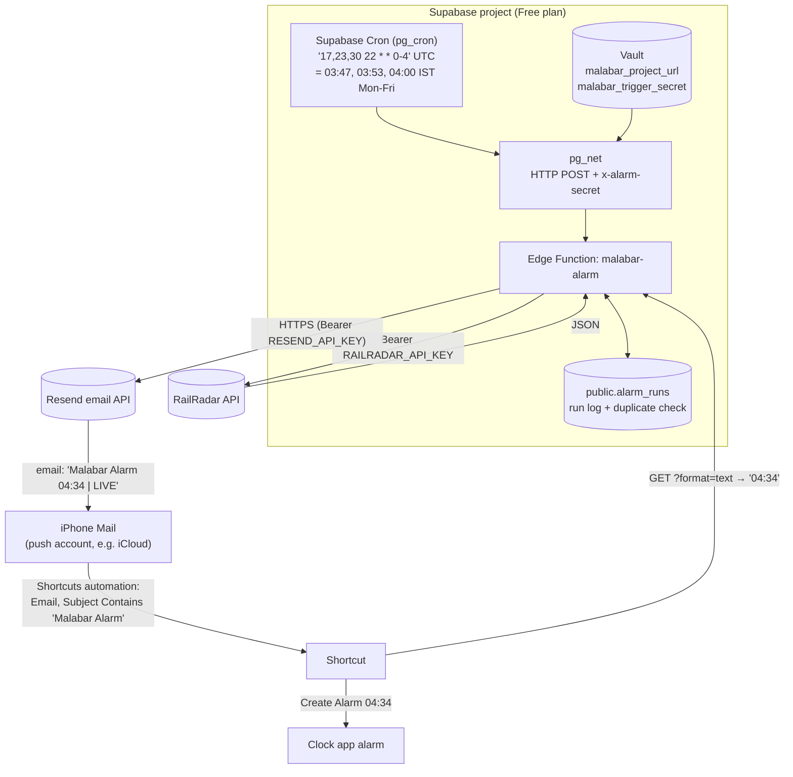

# Malabar Smart Alarm

Every Monday to Friday before dawn, this project checks the live running status of
**16630 Malabar Express** and works out when you need to wake up to catch it at
**Chengannur (CNGR)**. It then **emails you the wake-up time**. An **iPhone Shortcuts automation**
triggers on that email and **sets the alarm in the Clock app** for you.

```
Subject: Malabar Alarm 04:34 | LIVE | Thu 12 Nov 2026

WAKEUP=04:34
WAKEUP_ISO=2026-11-12T04:34:00+05:30
STATUS=LIVE

Train: Malabar Express (16630)
Boarding: Chengannur (CNGR)
Date: Thu 12 Nov 2026
Predicted arrival: 05:14 AM
Recommended wake-up: 04:34 AM
Buffer: 40 minutes
Delay: 23 minutes
Status: LIVE
Source: RailRadar (predicted)
```

It's free to run:

- **Supabase Free plan:** an Edge Function, plus Supabase Cron (pg_cron + pg_net) to run it on a schedule, plus a small Postgres table that logs each run and prevents duplicate emails
- **Resend:** sends the email through its HTTPS email API (free: 3,000 emails a month, 100 a day)
- **RailRadar API:** the live train data
- **iPhone Shortcuts:** an email-triggered automation that creates the alarm

> **Why email and not push notifications?** iPhone Shortcuts can run an automation when an email arrives,
> but not when a Telegram or ntfy notification arrives. An earlier version used ntfy.sh. Its free tier
> rejected messages from Supabase's shared servers ("daily message quota reached"), so it was replaced.

---

## Contents

1. [How it works](#how-it-works)
2. [What LIVE / SCHEDULED / FALLBACK mean](#status)
3. [Deployment checklist](#checklist)
4. [Supabase deployment (Steps 1–7)](#step-1)
5. [Email setup with Resend](#email)
6. [iPhone: the automation that sets the alarm](#iphone)
7. [Scheduling, timezones and delays](#scheduling)
8. [Free plan: keeping the project awake](#pausing)
9. [Changing train, station, buffer and schedule](#changing)
10. [Troubleshooting](#troubleshooting)
11. [Security and rotating credentials](#security)
12. [Running tests locally](#tests)
13. [Project structure](#structure)

---

<a id="how-it-works"></a>
## 1. How it works



Each scheduled run does this:

1. **Checks the caller.** The request must carry `x-alarm-secret`, and it must match `ALARM_TRIGGER_SECRET`.
2. **Checks the day.** It continues only on Monday to Friday in IST. Manual runs (`"force": true`) skip this check.
3. **Calls RailRadar** (`GET /v1/trains/16630/live`). It waits up to 15 seconds and retries once.
4. **Checks the response.** `success`, `data.train.number = 16630` and a route stop with `stationCode = CNGR` must all be present.
5. **Picks the arrival time at Chengannur** (arrival, not departure) and works out **wake-up = arrival − 40 min** in IST.
6. **Checks `alarm_runs`.** If today's email was already sent, it records `skipped` and stops.
7. **Emails you through Resend.** The run is recorded as `sent` only if Resend confirms it accepted the email.
8. **The iPhone takes over.** The email arrives, the Shortcuts automation runs, it reads the time and creates the alarm.

<a id="status"></a>
## 2. What LIVE / SCHEDULED / FALLBACK mean

| Status | When | Arrival used |
|---|---|---|
| **LIVE** | `actualArrival` for CNGR is present and valid | RailRadar's predicted (or actual) arrival |
| **SCHEDULED** | API worked but `actualArrival` is empty or invalid | `scheduledArrival` (timetable) |
| **FALLBACK** | API down, timed out, bad JSON, wrong train, CNGR missing, no times, **or the data is for a different day** | Configured timetable arrival `04:51` → wake-up **04:11** |

The status always appears in the subject, and anything other than LIVE also has a `Reason:` line.
Out-of-date data is never sent as LIVE.

**Duplicate protection:** the three runs each morning give you backups. The first successful run sends the email, and later
runs skip it. There's one exception: if an earlier email was SCHEDULED or FALLBACK and a later run gets a LIVE prediction, a
**second (LIVE) email** is sent. Your phone then creates a second alarm. The earlier, usually earlier-ringing, alarm stays,
which is the safe direction. Manual test emails are marked `| TEST` and never block the scheduled ones. Resend also
gets an idempotency key per date and status, so a retried request can't send a duplicate email.

---

<a id="checklist"></a>
## 3. Deployment checklist

- [ ] Supabase project linked; migrations pushed; function deployed ([Steps 1–5](#step-1))
- [ ] Vault secrets `malabar_project_url` and `malabar_trigger_secret` created ([Step 6](#step-6))
- [ ] Resend account created, API key copied ([Email setup](#email))
- [ ] Supabase secrets set: `RAILRADAR_API_KEY`, `RESEND_API_KEY`, `ALARM_EMAIL_TO`, `ALARM_TRIGGER_SECRET` ([Step 4](#step-4))
- [ ] `ALARM_EMAIL_TO` is a mail account that **pushes** to your iPhone, ideally iCloud ([Email setup](#email))
- [ ] iPhone Shortcuts automation created and set to *Run Immediately* ([iPhone](#iphone))
- [ ] Manual test email arrives, and the automation creates an alarm ([Step 7](#step-7))
- [ ] Next weekday: `alarm_runs` shows one `sent` row and two `skipped` rows, and the alarm is set
- [ ] For the first two weeks, check the dashboard to make sure the project isn't paused ([pausing](#pausing))

---

<a id="step-1"></a>
## Step 1 - Create a Supabase project

Go to <https://supabase.com> and click **New project**. Choose region **Mumbai**, plan **Free**, and save the database password.
Note the **project ref** from the URL: `https://supabase.com/dashboard/project/<project-ref>`.

<a id="step-2"></a>
## Step 2 - Link this folder

```bash
supabase login
```

```bash
supabase link --project-ref <project-ref>
```

<a id="step-3"></a>
## Step 3 - Create the table and schedule

```bash
supabase db push
```

This applies the migrations in [`supabase/migrations/`](supabase/migrations):

- the `alarm_runs` table, with Row Level Security on
- `pg_cron` and `pg_net`
- the `malabar-alarm` cron job and a daily clean-up job

The migrations contain no secrets.

<a id="step-4"></a>
## Step 4 - Set the function secrets

Add these at **Dashboard → Edge Functions → Secrets → Add new secret**:

| Name | Value | Required |
|---|---|---|
| `RAILRADAR_API_KEY` | Your RailRadar key: the part *after* `Bearer ` | Yes |
| `RESEND_API_KEY` | Your Resend API key (`re_…`) ([Email setup](#email)) | Yes |
| `ALARM_EMAIL_TO` | The address that receives the email. On Resend's free plan without your own domain, this must be **the address you signed up to Resend with** | Yes |
| `ALARM_TRIGGER_SECRET` | Generate it with `openssl rand -hex 32`. Keep it: Step 6, manual tests and the iPhone Shortcut use it | Yes |

**Optional settings:**

| Name | Default | Notes |
|---|---|---|
| `ALARM_EMAIL_FROM` | `Malabar Smart Alarm <onboarding@resend.dev>` | Change only after verifying your own domain in Resend |
| `EMAIL_SUBJECT_PREFIX` | `Malabar Alarm` | The iPhone automation matches this. It must not contain a time |
| `BUFFER_MINUTES` | `40` | |
| `FALLBACK_SCHEDULED_ARRIVAL` | `04:51` (24-hour clock, IST) | Timetable arrival used when the API fails |
| `MONITORING_DAYS` | `MON-FRI` | e.g. `MON-SAT` |
| `TRAIN_NUMBER` / `TRAIN_NAME` | `16630` / `Malabar Express` | |
| `BOARDING_STATION_CODE` / `BOARDING_STATION_NAME` | `CNGR` / `Chengannur` | |

Supabase gives every Edge Function `SUPABASE_URL` and the service key automatically, so you don't need to set those.

<a id="step-5"></a>
## Step 5 - Deploy the Edge Function

```bash
supabase functions deploy malabar-alarm --no-verify-jwt
```

The function doesn't require a Supabase login token. It protects itself with `ALARM_TRIGGER_SECRET` instead: a wrong or missing `x-alarm-secret` header gets `401`.

<a id="step-6"></a>
## Step 6 - Give the schedule its Vault secrets

In the **SQL Editor**, run this once:

```sql
select vault.create_secret('https://<project-ref>.supabase.co', 'malabar_project_url');
select vault.create_secret('<ALARM_TRIGGER_SECRET from Step 4>', 'malabar_trigger_secret');
```

<a id="step-7"></a>
## Step 7 - Test manually

Run these in the **Terminal app**, or in the Terminal panel beside the chat. Don't use the chat box, because it can't take typed input.
Paste the trigger secret when asked. It isn't shown on screen or saved in your shell history.

**Dry run.** It shows the email it would send, but sends nothing:

```bash
read -rs "S?Trigger secret: " && echo && curl -sS -X POST "https://<project-ref>.supabase.co/functions/v1/malabar-alarm" -H "x-alarm-secret: $S" -H "Content-Type: application/json" -d '{"force": true, "dry_run": true}'; unset S
```

**Real test email.** It also triggers your iPhone automation:

```bash
read -rs "S?Trigger secret: " && echo && curl -sS -X POST "https://<project-ref>.supabase.co/functions/v1/malabar-alarm" -H "x-alarm-secret: $S" -H "Content-Type: application/json" -d '{"force": true}'; unset S
```

**Latest wake-up.** This is what the iPhone Shortcut reads:

```bash
read -rs "S?Trigger secret: " && echo && curl -sS "https://<project-ref>.supabase.co/functions/v1/malabar-alarm?format=text" -H "x-alarm-secret: $S"; echo; unset S
```

| Body option | Meaning |
|---|---|
| `"force": true` | Manual run: ignores the weekday check, always sends, subject ends with `\| TEST`, never affects duplicate protection |
| `"dry_run": true` | Don't send. Return the email instead |
| `"skip_dedupe": true` | Scheduled-style run that sends even if one was already sent |

After 12:00 noon IST, a run checks **tomorrow morning's** arrival, which is tonight's train.

---

<a id="email"></a>
## Email setup with Resend

1. **Choose the receiving address first.** The iPhone automation can only react once the email reaches
   the phone, so use a mail account that **pushes** new mail instantly. **iCloud Mail** does. Gmail added
   to Apple Mail only fetches on a timer, which can make the automation run late.
2. **Sign up at <https://resend.com/signup> with that same address.** On the free plan, until you verify your
   own domain, Resend only delivers to the address you signed up with, sent from `onboarding@resend.dev`.
3. In Resend, go to **API Keys → Create API Key**. Choose *Sending access*, then copy the `re_…` key.
4. Add the Supabase secrets `RESEND_API_KEY` (the key) and `ALARM_EMAIL_TO` (the address from step 1).
5. Send a real test (Step 7) and check the email arrives in the iPhone **Mail** app, not in Junk.
   If it lands in Junk, mark it **Not Junk** and add `onboarding@resend.dev` to your contacts or VIPs.

<a id="iphone"></a>
## iPhone: the automation that sets the alarm

You need iOS 17 or later, so that automations can run without asking for confirmation each time.

### A. Create the shortcut actions

1. Open **Shortcuts → Automation** tab → **+** (New Automation) → **Email**.
2. Set the trigger:
   - **Subject Contains:** `Malabar Alarm`
   - **Sender:** `onboarding@resend.dev` (optional, but stops other emails from triggering it)
   - **Account:** the account from `ALARM_EMAIL_TO`
3. Choose **Run Immediately**, then **Next** → **New Blank Automation**.
4. Add these actions:

   1. **Get Contents of URL**
      - URL: `https://<project-ref>.supabase.co/functions/v1/malabar-alarm?format=text`
      - Tap ▸ to show more options. Set **Method: GET**. Under **Headers**, add the key `x-alarm-secret` with your trigger secret as the value.
      - This returns the wake-up time as plain text, for example `04:34`.
   2. **Get Dates from Input**, with the input set to *Contents of URL*.
   3. **Create Alarm**
      - **Time:** *Dates*
      - **Label:** `Malabar Express`
      - **Repeat:** none

5. Tap **Done**.

**Why the Shortcut reads the time from the Supabase function instead of the email:** that request always returns
the latest time that was emailed. It doesn't depend on whether iOS passes the email's contents to the shortcut.
If you'd rather not store the trigger secret on your phone, and your iOS version passes the email to the
automation as *Shortcut Input*, use **Match Text** with the pattern `\d{2}:\d{2}` on *Shortcut Input*
instead of step 1. The first time in the subject is always the wake-up time. Test this before relying on it.

### B. Test the shortcut on its own

In the automation, tap ▶︎ to run it once. You should see a new **Malabar Express** alarm in **Clock** at the
time returned by the function. If it says nothing has been sent yet (`NONE`), send a manual test email first (Step 7).

### C. Things to know

- **A new alarm is created each time.** I didn't find a reliable Shortcuts action for changing an existing
  alarm's time, so each email creates a new alarm. Delete old **Malabar Express** alarms in Clock now and
  then. Check whether your iOS version has a *Delete Alarms* action you could add at the start of the shortcut.
- **Notifications:** iOS shows a small notification when an automation runs. This is normal.
- **Keep a backup:** until you've seen it work for a few mornings, keep a normal Clock alarm at 04:11 (the fallback time).
- **Focus / Sleep:** automations run during Sleep Focus, but make sure **Mail** is allowed to deliver in the background:
  Settings → Mail → Notifications, and Settings → General → Background App Refresh.

---

<a id="scheduling"></a>
## Scheduling, timezones and delays

- Supabase Cron (pg_cron) runs in **UTC**. 03:47, 03:53 and 04:00 IST Monday to Friday are
  **22:17, 22:23 and 22:30 UTC Sunday to Thursday**, so the schedule is `'17,23,30 22 * * 0-4'`. A test checks every one of those times against IST.
- The function also checks the weekday in IST, so a wrong schedule still can't send on a weekend.
- **The full chain takes a few minutes.** pg_net starts the request within seconds. A run takes up to about a minute when
  RailRadar is slow. Then delivery from Resend to your inbox and Apple Mail push usually add seconds to a minute or two. The first
  run is at 03:47, well before the earliest fallback wake-up time of 04:11.
- **See what ran:**
  ```sql
  select jobid, status, start_time, return_message from cron.job_run_details order by start_time desc limit 10;
  select id, status_code, created from net._http_response order by created desc limit 10;
  select created_at at time zone 'Asia/Kolkata' as ist, journey_date, status, outcome, manual,
         wakeup at time zone 'Asia/Kolkata' as wakeup_ist, detail
    from public.alarm_runs order by created_at desc limit 10;
  ```

<a id="pausing"></a>
## Free plan: keeping the project awake

Supabase **pauses Free-plan projects after about a week of low activity**, and a paused project runs no cron jobs.
Every run, including skipped ones, reads and writes `alarm_runs`, at least every 3 days. Supabase doesn't say
officially whether that counts as activity, so **watch it for the first two weeks**. Supabase emails you before pausing, and you can
restore a paused project from the dashboard.

---

<a id="changing"></a>
## Changing train, station, buffer and schedule

- **Buffer, fallback time, days, station or train:** set the matching secret (Step 4). It takes effect on the next run, without redeploying.
- **Run time:** convert IST to UTC (subtract 5 h 30 min; before midnight means the UTC day is the previous day), then:
  ```sql
  select cron.alter_job(job_id := (select jobid from cron.job where jobname = 'malabar-alarm'),
                        schedule := '45 21 * * 0-4');  -- = 03:15 IST Mon-Fri
  ```
- **Pause during holidays:** `select cron.alter_job(job_id := (select jobid from cron.job where jobname = 'malabar-alarm'), active := false);`
  Use `active := true` to resume. Pausing also stops the database activity, so the project may get paused after a week.
- **Subject prefix:** if you change `EMAIL_SUBJECT_PREFIX`, update the automation's *Subject Contains* to match.

---

<a id="troubleshooting"></a>
## Troubleshooting

Logs are at **Dashboard → Edge Functions → malabar-alarm → Logs**. Lines start with `[malabar]`.

| Symptom / message | Meaning and fix |
|---|---|
| `401 Unauthorized` | Wrong `x-alarm-secret`. For scheduled runs, the Vault secret `malabar_trigger_secret` must equal `ALARM_TRIGGER_SECRET` |
| `RESEND_API_KEY is not configured` / `ALARM_EMAIL_TO is missing` (500) | Add the secret (Step 4) |
| `Email send failed (HTTP 403: You can only send testing emails to your own email address…)` | Without a verified domain, `ALARM_EMAIL_TO` must be your Resend sign-up address |
| `Email send failed (HTTP 401/403 …API key…)` | The Resend key is wrong or was revoked. Create a new one |
| `Email send failed (HTTP 429)` | Resend rate limit or daily quota reached (free: 100 a day). Normal use is 1–2 a day |
| `RailRadar rejected the API key (HTTP 401/403)` | Re-enter `RAILRADAR_API_KEY` without `Bearer ` |
| `API data is for the journey reaching CNGR on <date>` | RailRadar was showing a different day's journey. A FALLBACK was sent on purpose |
| Run says `sent` but no email | Check Junk/Spam and the Resend dashboard (**Emails**) for the delivery status |
| Email arrives but no alarm | Check the automation is set to *Run Immediately* and matches the subject and sender. Check the mail account pushes (iCloud). Run the shortcut by hand to test |
| Shortcut returns `NONE` | No email has been sent yet for this journey date. Send a manual test |
| No runs at all | Check `cron.job_run_details`. Check the project isn't **paused**. Check the Vault secrets (Step 6) |

**Test the RailRadar API directly from your Mac:**

```bash
read -rs "K?RailRadar key: " && echo && curl -sS -H "Authorization: Bearer $K" https://api.railradar.in/v1/trains/16630/live | python3 -m json.tool | head -60; unset K
```

---

<a id="security"></a>
## Security and rotating credentials

- **Secrets stay out of git.** They're kept only in Supabase secrets and Vault, and `.gitignore` excludes `.env*` files.
- **Nothing secret is logged or returned.** The function never logs or returns the RailRadar key, the Resend key or the trigger secret. Error messages are written by the code itself, and keys are scrubbed from provider messages. Tests check this.
- **Every call is checked.** The function requires the trigger secret, compared in constant time.
- **The run log is locked down.** `alarm_runs` has Row Level Security on with no policies, and access is revoked from `anon`/`authenticated`.
- **Your iPhone stores the trigger secret** in the shortcut. Anyone with it can trigger an extra test email to *you* or read your wake-up time. They can't do anything else.

**Changing credentials:**

- **RailRadar or Resend key:** create a new key → update the Supabase secret → do a dry run or real test → revoke the old key.
- **Trigger secret:** `openssl rand -hex 32` → update `ALARM_TRIGGER_SECRET`, **the Vault secret**
  (`select vault.update_secret((select id from vault.secrets where name = 'malabar_trigger_secret'), '<new>');`),
  **and the header in the iPhone shortcut**.

---

<a id="tests"></a>
## Running tests locally

```bash
cd supabase/functions && deno test --allow-read tests/
```

69 tests, with no network access and no real keys. They cover:

- a successful API response
- finding Chengannur in the response
- the 40-minute calculation
- falling back to the scheduled arrival
- Chengannur missing from the response
- a missing predicted arrival
- invalid API responses
- timeouts
- the email subject and body format the iPhone Shortcut depends on
- the Resend request, errors and retries
- converting times to IST
- weekday scheduling and the UTC-to-IST date change, including every cron firing
- out-of-date journey data
- duplicate protection
- the latest-wake-up endpoint
- authentication
- the run log
- configuration parsing

<a id="structure"></a>
## Project structure

```
malabar-smart-alarm/
├── supabase/
│   ├── config.toml                       # malabar-alarm: verify_jwt = false
│   ├── migrations/
│   │   ├── 20261111180000_malabar_alarm.sql   # alarm_runs table, RLS, pg_cron schedule
│   │   └── 20261112000000_email_delivery.sql  # ntfy_message_id -> message_id
│   └── functions/
│       ├── malabar-alarm/
│       │   ├── index.ts                  # Deno.serve entry point
│       │   ├── handler.ts                # auth, POST run / GET latest, duplicate rule
│       │   ├── config.ts                 # defaults + secret overrides + validation
│       │   ├── railradar.ts              # RailRadar client
│       │   ├── train.ts                  # response validation, CNGR extraction, timestamps
│       │   ├── alarm.ts                  # LIVE/SCHEDULED/FALLBACK, wake-up maths
│       │   ├── notify.ts                 # email content (Shortcut-readable) + Resend client
│       │   ├── store.ts                  # alarm_runs via the REST API
│       │   ├── time.ts / http.ts / log.ts
│       └── tests/                        # Deno tests + mock API response
├── .gitignore
└── README.md
```
