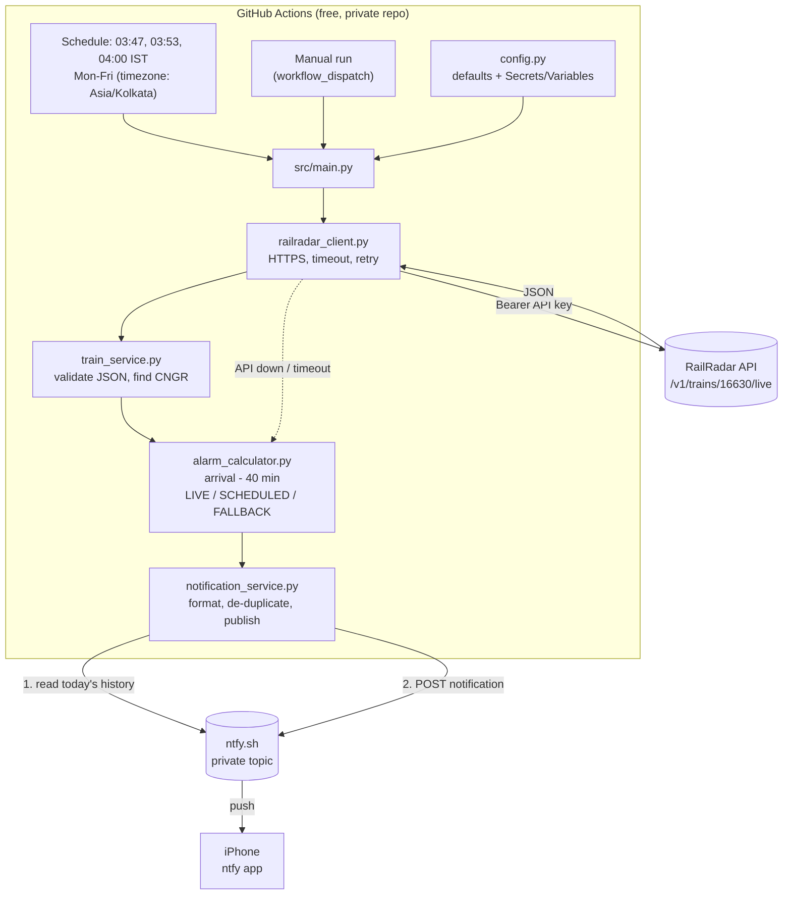

# Malabar Smart Alarm

Every Monday to Friday before dawn, this project checks the live running status of
**16630 Malabar Express**. It works out when you should wake up to catch the train at
**Chengannur (CNGR)** and sends that time to your iPhone as a push notification through **ntfy**.

```
Malabar Smart Alarm
Train: Malabar Express (16630)
Boarding: Chengannur (CNGR)
Date: Thu 12 Nov 2026
Predicted arrival: 05:14 AM
Recommended wake-up: 04:34 AM
Buffer: 40 minutes
Delay: 23 minutes
Status: LIVE
Source: RailRadar (predicted)
Ref: 16630/2026-11-12/LIVE
```

It costs nothing to run. It uses GitHub Actions (free tier), Python (no extra packages), the RailRadar API and ntfy.sh (free tier).

> **Important:** This sends a **notification**. It does **not** create or change alarms in the
> iPhone Clock app. Configure ntfy as described below so the notification can wake you.

---

## Contents

1. [How it works](#how-it-works)
2. [What LIVE / SCHEDULED / FALLBACK mean](#status-meanings)
3. [Deployment checklist](#deployment-checklist)
4. [Step 1 - Create a private GitHub repository](#step-1)
5. [Step 2 - Upload the project](#step-2)
6. [Step 3 - Create your ntfy topic](#step-3)
7. [Step 4 - Install ntfy on iPhone and allow notifications](#step-4)
8. [Step 5 - Configure GitHub Actions Secrets](#step-5)
9. [Step 6 - Run the workflow manually](#step-6)
10. [Step 7 - Verify the notification](#step-7)
11. [Scheduling and why runs can be late](#scheduling)
12. [Changing train, station, buffer and schedule](#changing)
13. [Troubleshooting](#troubleshooting)
14. [Security and rotating credentials](#security)
15. [Running tests locally](#tests)
16. [Project structure](#structure)

---

<a id="how-it-works"></a>
## 1. How it works



Each run does this:

1. Calls `GET https://api.railradar.in/v1/trains/16630/live` with your API key. It waits up to 20 seconds and retries once on a timeout or server error.
2. Checks the answer: `success` must be true, `data.train.number` must be `16630`, and `data.route[]` must contain a stop with `stationCode = CNGR`.
3. Picks the arrival time at Chengannur. It uses arrival, not departure.
4. **Wake-up = arrival − 40 minutes**, using India time (Asia/Kolkata).
5. Reads your ntfy topic's messages from the last 12 hours. If today's notification was already sent, it stops here.
6. Sends the notification. The run reports success only if ntfy confirms it received the message.

<a id="status-meanings"></a>
## 2. What LIVE / SCHEDULED / FALLBACK mean

| Status | When | Arrival used |
|---|---|---|
| **LIVE** | `actualArrival` for CNGR is present and valid | RailRadar's predicted (or actual) arrival |
| **SCHEDULED** | API worked but `actualArrival` is empty or invalid | `scheduledArrival` (timetable) |
| **FALLBACK** | API down, timed out, bad JSON, wrong train, CNGR missing, no times, **or the data is for a different day** | The configured timetable arrival `04:51` → wake-up **04:11** |

Anything other than LIVE has the status in its title and includes a `Reason:` line. Out-of-date data is never presented as LIVE. If the API is still showing yesterday's journey, you get a FALLBACK.

The `provenance` value that RailRadar sends, for example `predicted`, is shown exactly as received on the `Source:` line.

**Duplicate protection.** Three runs are scheduled each morning so that one late or dropped run doesn't mean no notification. The first run sends the notification. Later runs see the `Ref: 16630/<date>/<STATUS>` line in your ntfy history and skip. There is one exception: if the earlier notification was SCHEDULED or FALLBACK and a later run gets a LIVE prediction, the LIVE one is sent as an update. Manual test runs are marked `/manual` so they never block the next morning's real notification.

---

<a id="deployment-checklist"></a>
## 3. Deployment checklist

- [ ] Create a **private** GitHub repository ([Step 1](#step-1))
- [ ] Push this project to it, on the default branch `main` ([Step 2](#step-2))
- [ ] Generate a long, random ntfy topic name ([Step 3](#step-3))
- [ ] Install **ntfy** from the App Store and subscribe to the topic ([Step 4](#step-4))
- [ ] Allow ntfy notifications: Lock Screen, Sounds, Banners, Time Sensitive, Focus exceptions ([Step 4](#step-4))
- [ ] Add secrets `RAILRADAR_API_KEY` and `NTFY_TOPIC` ([Step 5](#step-5))
- [ ] Actions tab → **Tests** workflow is green
- [ ] Actions tab → **Malabar Smart Alarm** → **Run workflow** with *Dry run* ticked, then check the log ([Step 6](#step-6))
- [ ] Run it again without *Dry run* and confirm the iPhone notification arrives ([Step 7](#step-7))
- [ ] Next weekday morning, check that one scheduled run sent the notification and the other runs logged `Not sending: already sent`

---

<a id="step-1"></a>
## Step 1 - Create a private GitHub repository

1. Sign in at <https://github.com> and click **+** (top right) → **New repository**.
2. Repository name: `malabar-smart-alarm`.
3. Select **Private**. This keeps your configuration and run logs out of public view.
4. Do **not** tick "Add a README" (this project already has one). Click **Create repository**.

<a id="step-2"></a>
## Step 2 - Upload the project

**Option A - command line (recommended).** In Terminal:

```bash
cd /path/to/malabar-smart-alarm
```

```bash
git init -b main
```

```bash
git add . && git commit -m "Initial commit: Malabar Smart Alarm"
```

```bash
git remote add origin https://github.com/<your-username>/malabar-smart-alarm.git
```

```bash
git push -u origin main
```

**Option B - web upload.** On the empty repository page, click **uploading an existing file** and drag in
all the files and folders. Finder hides the `.github` folder, so press `Cmd + Shift + .` to show hidden
files first, and check that `.github/workflows/malabar-alarm.yml` was uploaded.

> Scheduled workflows only run from the **default branch** (normally `main`).

<a id="step-3"></a>
## Step 3 - Create your ntfy topic

On the public ntfy.sh server, a topic doesn't need to be created and has no password. **Anyone who knows the topic name can read
and post to it**, so treat the name like a password and make it long and random:

```bash
python3 -c "import secrets; print('malabar-' + secrets.token_urlsafe(18))"
```

You'll get something like `malabar-Xy3k...`. Keep it private: it goes only into the ntfy app and a GitHub Secret.
Allowed characters are letters, digits, `-` and `_`, up to 64 characters.

<a id="step-4"></a>
## Step 4 - Install ntfy on iPhone and allow notifications

1. Install **ntfy** from the App Store (publisher: Philipp Heckel).
2. Open it, tap **+**, paste your topic name, keep the server as `https://ntfy.sh`, and tap **Subscribe**.
3. When iOS asks **"ntfy Would Like to Send You Notifications"**, tap **Allow**.
4. Open iPhone **Settings → Notifications → ntfy** and turn on:
   - **Allow Notifications**
   - **Lock Screen**, **Notification Centre**, **Banners** (choose *Persistent* so it stays on screen)
   - **Sounds**
   - **Time Sensitive Notifications**, if shown
5. If you use **Sleep Focus / Do Not Disturb**: go to **Settings → Focus → Sleep → Apps** and add **ntfy**
   so the notification can get through overnight.
6. Test it from your Mac. Replace the topic with yours:

   ```bash
   curl -H "Title: Test" -H "Priority: 5" -d "Hello from my Mac" https://ntfy.sh/YOUR-TOPIC
   ```

   The notification should appear on your phone within a few seconds.

> Notifications are sent with priority 5 (max). To be safe, keep a regular Clock alarm at your
> earliest usual time (for example the 04:11 fallback) as a backup, and adjust it when the notification arrives.

<a id="step-5"></a>
## Step 5 - Configure GitHub Actions Secrets

In your repository: **Settings → Secrets and variables → Actions → Secrets tab → New repository secret**.

| Name | Value | Required |
|---|---|---|
| `RAILRADAR_API_KEY` | Your RailRadar API key: the part *after* `Bearer `, without quotes | Yes |
| `NTFY_TOPIC` | The topic name from Step 3 (just the name, not the URL) | Yes |
| `NTFY_TOKEN` | An ntfy access token. Only needed if you use protected topics or a self-hosted server | No |

GitHub encrypts secrets and hides them in logs as `***`. The code never prints them either.

**Optional settings** go in the **Variables** tab next to Secrets. These values aren't secret. If you leave one unset, the default applies.

| Variable | Default | Example |
|---|---|---|
| `BUFFER_MINUTES` | `40` | `30` |
| `FALLBACK_SCHEDULED_ARRIVAL` | `04:51` (24-hour clock) | `04:45` |
| `MONITORING_DAYS` | `MON-FRI` | `MON-SAT` |
| `TRAIN_NUMBER` / `TRAIN_NAME` | `16630` / `Malabar Express` | |
| `BOARDING_STATION_CODE` / `BOARDING_STATION_NAME` | `CNGR` / `Chengannur` | `KTYM` / `Kottayam` |
| `NTFY_PRIORITY` | `5` | `4` |
| `NTFY_SERVER` | `https://ntfy.sh` | your server (HTTPS only) |

<a id="step-6"></a>
## Step 6 - Run the workflow manually

1. Open the **Actions** tab. If GitHub asks, click **I understand my workflows, go ahead and enable them**.
2. Select **Malabar Smart Alarm** on the left → **Run workflow** (on the right).
3. The options:
   - **Dry run**: works out everything and prints the message in the log, but sends nothing. Good for a first test.
   - **Send even if a notification was already sent today**: on by default for manual runs.
4. Click the green **Run workflow** button, then open the run → **notify** job → **Check train and notify**.

Manual runs skip the weekday check, so you can test on a weekend. After 12:00 noon IST, a manual run
looks at **tomorrow morning's** arrival, which is tonight's train. Before noon it looks at today's.

<a id="step-7"></a>
## Step 7 - Verify the notification

- The phone shows **Malabar Smart Alarm** with the train, the times and `Status: LIVE`. Manual runs end with `/manual`.
- The log shows `ntfy accepted the notification (id=..., status=LIVE)`.
- The run's **Summary** page shows a short table with the status, arrival and wake-up times.
- If the run is **red**, the notification was **not** delivered. See [Troubleshooting](#troubleshooting).
- A **yellow warning** means a SCHEDULED or FALLBACK notification was sent instead of a LIVE one. The reason is shown.

---

<a id="scheduling"></a>
## Scheduling and why runs can be late

`.github/workflows/malabar-alarm.yml`:

```yaml
on:
  schedule:
    - cron: '47 3 * * 1-5'
      timezone: 'Asia/Kolkata'
    - cron: '53 3 * * 1-5'
      timezone: 'Asia/Kolkata'
    - cron: '0 4 * * 1-5'
      timezone: 'Asia/Kolkata'
```

- GitHub's official docs confirm that schedules accept an IANA `timezone`. Without it, cron times are
  **UTC**. The equivalent UTC lines are in a comment in the workflow file. IST is UTC+5:30, so 04:00 IST
  Monday is **22:30 UTC Sunday**. That's why the UTC version uses `0-4` (Sun–Thu) instead of `1-5`.
- **Scheduled runs are not exact.** GitHub queues them, and when it's busy, especially at the top of
  each hour, a run can start many minutes late, and some runs are **dropped**. That's why there are three runs,
  starting at 03:47. The program also notes in the message if the recommended wake-up time has already passed.
- Schedules only run from the latest commit on the default branch.
- GitHub turns off schedules after 60 days without activity **only in public repositories**. This repository is private.
- Free-tier usage: each run takes well under a minute, and GitHub bills each job as at least 1 minute. About 3 × 22 weekdays ≈ 66 minutes a month,
  plus test runs. GitHub Free includes 2,000 minutes a month for private repositories.
- `concurrency` stops two alarm runs from overlapping.

<a id="changing"></a>
## Changing train, station, buffer and schedule

- **Buffer / fallback / days / station / train:** set the matching **Variable** (Step 5). No code change is needed.
  The defaults are in [`src/config.py`](src/config.py).
- **Fallback time:** set `FALLBACK_SCHEDULED_ARRIVAL` to the **timetable arrival** at your station. The
  fallback wake-up time is that minus the buffer (04:51 − 40 = 04:11).
- **Different boarding station:** set `BOARDING_STATION_CODE`, using the code exactly as it appears in the API's `route[]`,
  plus `BOARDING_STATION_NAME`, and update `FALLBACK_SCHEDULED_ARRIVAL`. Then do a dry run to check.
- **Notification time:** edit the `cron` lines in `malabar-alarm.yml`. The format is `minute hour * * days`, in the
  timezone shown. For example, `'15 3 * * 1-5'` is 03:15 Mon–Fri. Keep the runs at least 15–20 minutes
  before your earliest possible wake-up time, and avoid minute `0` if you can. Commit and push to `main`.
- **A train arriving in the afternoon or evening:** the program assumes the journey being checked arrives
  on the day of the run (before noon). For other trains, adjust `monitoring_date_for` in `src/main.py`.

<a id="troubleshooting"></a>
## Troubleshooting

Open **Actions → the run → notify → Check train and notify** and look at the log.

| Log / notification says | Meaning and fix |
|---|---|
| `RailRadar rejected the API key (HTTP 401/403)` | The key is wrong or expired. Re-copy it into `RAILRADAR_API_KEY` without `Bearer ` and without spaces. |
| `RailRadar has no live data for this train (HTTP 404)` | The train number is wrong, or the train isn't running today. |
| `RailRadar returned HTTP 429` | Rate limited. Check your RailRadar plan's limits. |
| `request timed out` / `Network error` | RailRadar was slow or unreachable. A FALLBACK was sent. The next scheduled run will try again. |
| `invalid JSON` / `unexpected JSON structure` | The API returned an error page or changed format. Try the request with curl (below). |
| `station CNGR not found in route` | Check the station code in the API's `route[]`. |
| `API data is for the journey reaching CNGR on <date>` | RailRadar was still showing a different day's journey. A FALLBACK was sent on purpose. |
| `No live prediction ... using timetable` (SCHEDULED) | The API had no `actualArrival` yet. |
| `NTFY_TOPIC is missing or invalid` (exit code 2) | Add the secret. Use only letters, digits, `-` and `_`. |
| `Notification NOT delivered` (red run) | ntfy rejected the message or couldn't be reached. Check ntfy.sh status and your topic/token. |
| Run is green, but no notification on the phone | Check the phone is subscribed to the exact same topic, and check Step 4 settings and Focus. |
| `Not sending: already sent` | Working as designed. To force a resend, run manually with the resend option ticked. |
| No scheduled runs at all | The workflow file must be on the default branch, and Actions must be enabled (Settings → Actions → General). |

**Test the API from your Mac.** Paste the key when prompted. It's read silently and isn't saved in your shell history:

```bash
read -rs RR_KEY && curl -sS -H "Authorization: Bearer $RR_KEY" https://api.railradar.in/v1/trains/16630/live | python3 -m json.tool | head -60; unset RR_KEY
```

**Dry run locally against the live API.** This prints the message and sends nothing:

```bash
read -rs RAILRADAR_API_KEY && export RAILRADAR_API_KEY && python3 -m src.main --dry-run --force; unset RAILRADAR_API_KEY
```

<a id="security"></a>
## Security and rotating credentials

- The API key and ntfy topic are kept only in **GitHub Secrets** and are never committed to the repository. `.gitignore` excludes
  `.env` files.
- The code never logs the `Authorization` header, the API key, the ntfy topic or the token. Error messages are
  written by the code itself, not copied from raw responses, and `repr()` hides secrets.
- All connections use HTTPS, and plain `http://` addresses are rejected. The workflow has only `contents: read` permission
  and checks out code with `persist-credentials: false`.
- Keep the repository private.

**Changing the RailRadar key:** create a new key in your RailRadar account → update the
`RAILRADAR_API_KEY` secret (Settings → Secrets → ✏️) → run the workflow manually to test → revoke the old key.

**Changing the ntfy topic** (if you think someone else knows it): generate a new topic (Step 3) → update the
`NTFY_TOPIC` secret → subscribe to the new topic in the ntfy app and delete the old subscription → test with a manual run.

**If a secret was ever committed by mistake:** change it immediately. Removing it from the repository's history isn't enough.

<a id="tests"></a>
## Running tests locally

The tests need only Python 3.9 or newer. They make no network calls and use no real keys.

```bash
python3 -m unittest discover -s tests -t . -v
```

They cover:

- a successful API response
- finding Chengannur in the response
- the 40-minute calculation
- falling back to the scheduled arrival
- Chengannur missing from the response
- a missing predicted arrival
- invalid API responses
- network timeouts
- building the notification
- converting times to IST
- weekday scheduling and the UTC-to-IST date change
- out-of-date journey data
- duplicate detection
- delivery failures
- configuration parsing

They also check the schedule in the workflow file.

The sample API response used in the tests is in [`tests/fixtures/railradar_live_16630.json`](tests/fixtures/railradar_live_16630.json).

<a id="structure"></a>
## Project structure

```
malabar-smart-alarm/
├── .github/workflows/
│   ├── malabar-alarm.yml       # scheduled alarm (03:47/03:53/04:00 IST, Mon-Fri) + manual run
│   └── tests.yml               # unit tests on every push (kept separate so tests never block the alarm)
├── src/
│   ├── __init__.py
│   ├── config.py               # defaults + environment overrides + validation
│   ├── railradar_client.py     # HTTPS client: timeout, retry, error handling
│   ├── train_service.py        # response validation, CNGR extraction, timestamp parsing
│   ├── alarm_calculator.py     # LIVE/SCHEDULED/FALLBACK decision, wake-up maths
│   ├── notification_service.py # ntfy message, duplicate detection, publish
│   └── main.py                 # orchestration, exit codes, CLI flags
├── tests/                      # unittest suite + mock API response
├── .gitignore
├── requirements.txt            # empty: standard library only
└── README.md
```

**Exit codes:** `0` = sent or intentionally skipped; `1` = not delivered, or API key missing (a FALLBACK was still sent);
`2` = configuration error.
